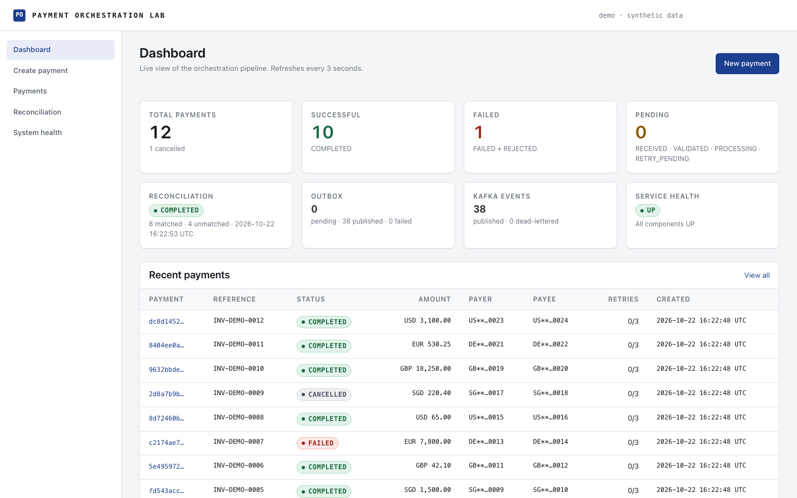
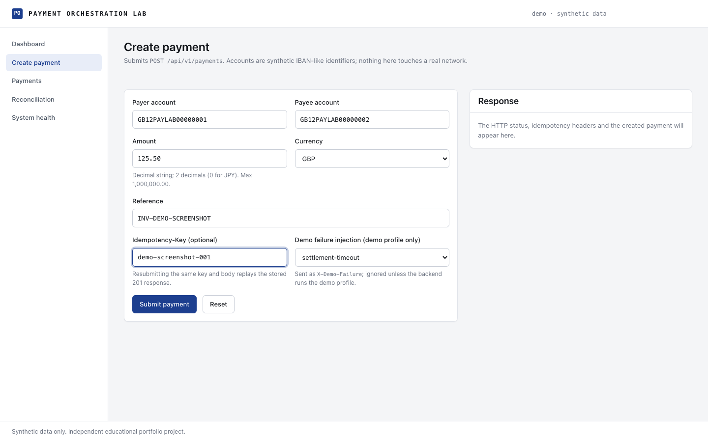
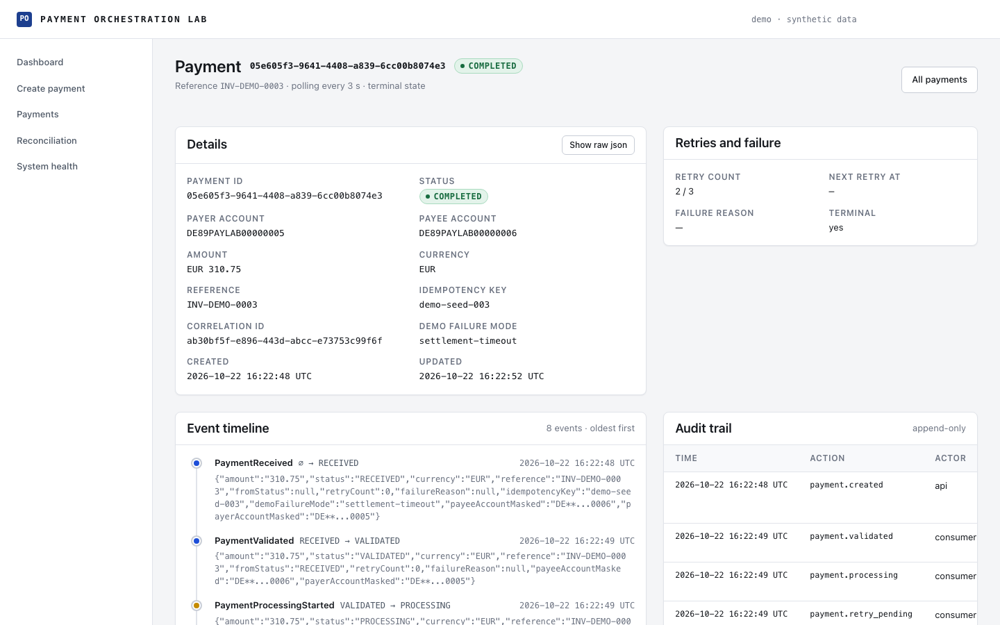
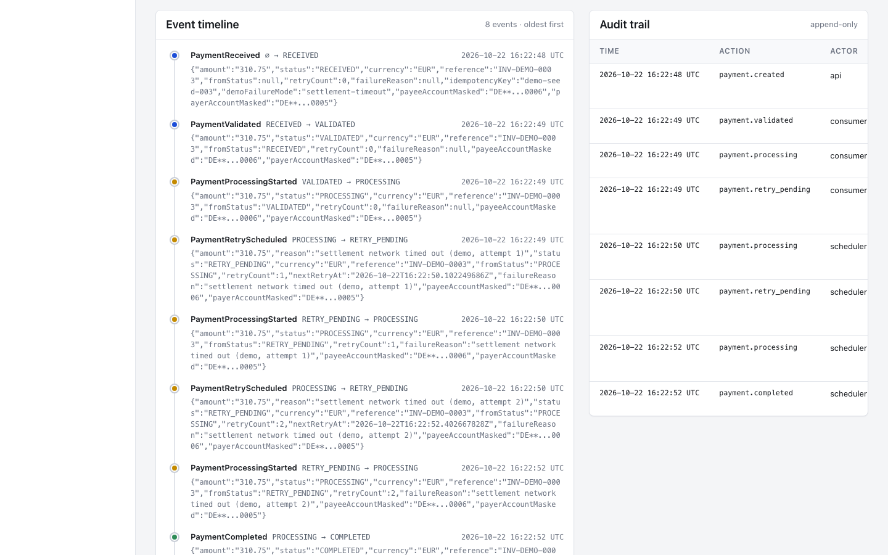
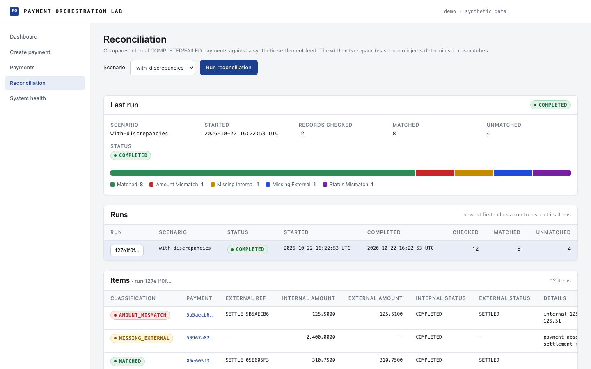
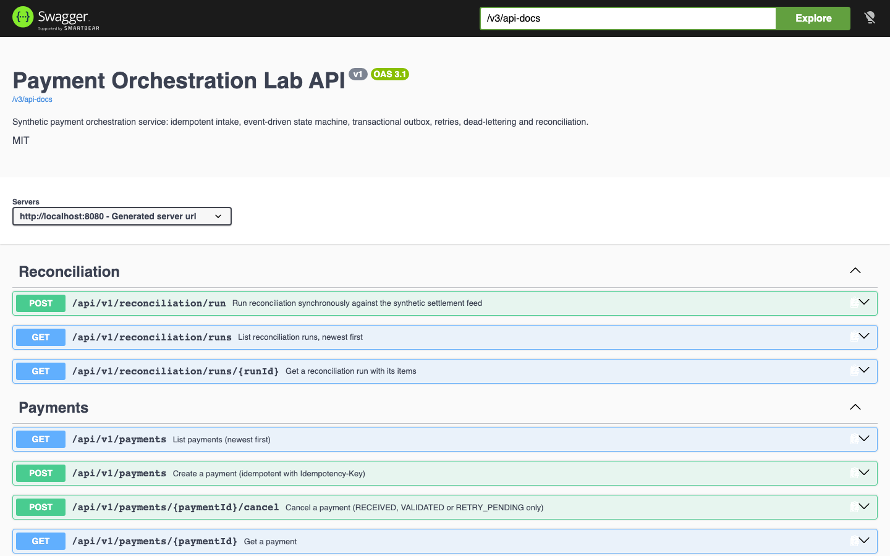
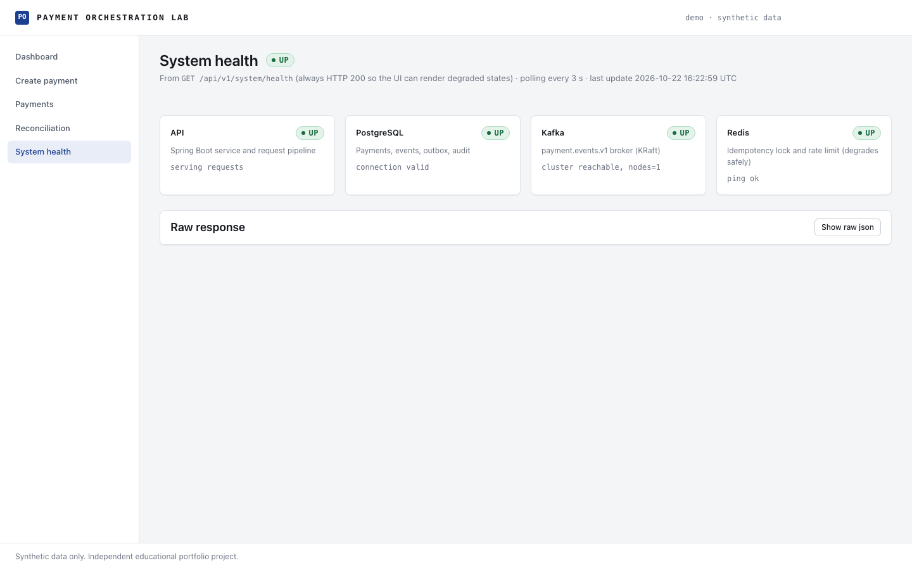
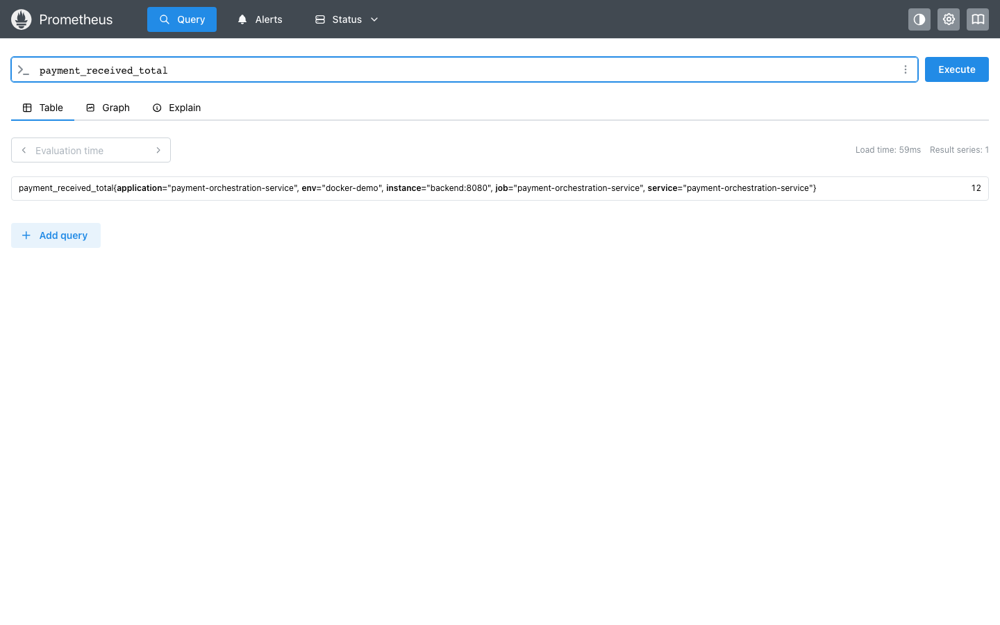
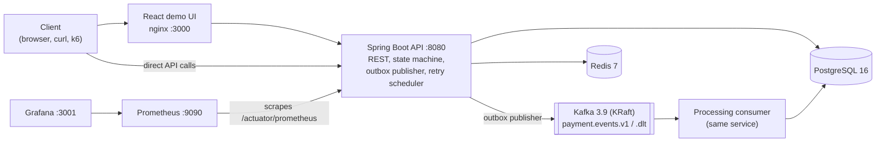
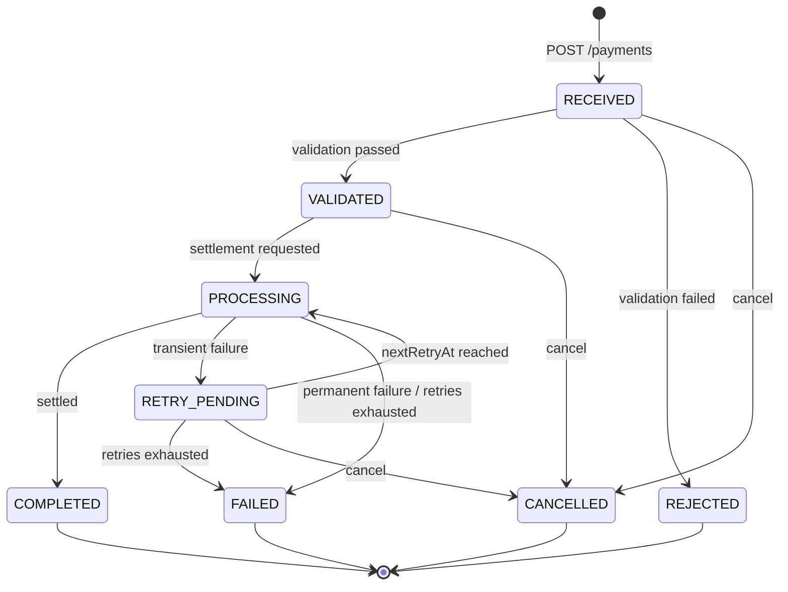

# Payment Orchestration Service

An event-driven payment orchestration service built with Java 21 and Spring Boot 3: it accepts
payment instructions over REST with strict idempotency, drives an explicit payment state machine
through Kafka using the transactional outbox pattern, retries transient settlement failures with
bounded exponential backoff, dead-letters poison messages, reconciles its records against a
synthetic settlement feed, keeps an append-only audit trail, and exposes structured logs, health
and Prometheus metrics. A small React UI, a Grafana dashboard and a scripted demo make the
behaviour visible end to end.

[](https://github.com/Adetlo/payment-orchestration-service/actions/workflows/ci.yml)
[](https://github.com/Adetlo/payment-orchestration-service/actions/workflows/codeql.yml)
[](https://openjdk.org/projects/jdk/21/)
[](https://spring.io/projects/spring-boot)
[](LICENSE)
[](https://github.com/Adetlo/payment-orchestration-service/tags)

> **Disclaimer.** This is an independent educational portfolio project using synthetic data. It does not contain employer source code, confidential architecture, production configuration, customer data or proprietary banking logic. It is not affiliated with or endorsed by any bank, payment network or employer.

## Demo



## Payment lifecycle

<table>
  <tr>
    <td width="50%"></td>
    <td width="50%"></td>
  </tr>
  <tr>
    <td colspan="2"></td>
  </tr>
</table>

## Reconciliation



## API



## System health and metrics





## Why this project exists

Payment platforms are mostly about guarantees rather than features: a retry must never create
a second payment, a state change must never be lost between the database and the message
broker, a stuck message must not block everything behind it, and at the end of the day the
books must balance against the settlement side. This repository implements those guarantees
in a small, readable codebase with real infrastructure (PostgreSQL, Kafka, Redis) and shows the
evidence: tests, metrics, a dashboard, a scripted demo and honest benchmarks. It is a
portfolio piece, written from public patterns on synthetic data.

## Architecture



The request path, the outbox publisher, the Kafka consumer and the reconciliation flow are
described with sequence and flow diagrams in [docs/ARCHITECTURE.md](docs/ARCHITECTURE.md). The
contract every component follows is [docs/DESIGN.md](docs/DESIGN.md).

## Payment lifecycle in detail



Every transition is validated by an explicit transition table and writes a payment event, an
audit entry and (when externally visible) an outbox event in the same database transaction.
Retries use `2^retryCount` seconds of backoff capped at 30 s, with at most 3 retries.

## Key engineering decisions

* [ADR 0001](docs/adr/0001-spring-boot.md): Java 21 and Spring Boot 3, with a Spring-free domain layer.
* [ADR 0002](docs/adr/0002-postgresql.md): PostgreSQL as the only system of record; constraints, `SKIP LOCKED` and an append-only audit trigger enforced in the database.
* [ADR 0003](docs/adr/0003-transactional-outbox.md): transactional outbox, because a direct database + Kafka dual write cannot be atomic.
* [ADR 0004](docs/adr/0004-kafka-events.md): versioned JSON event envelope, Kafka key = `paymentId` for per-payment ordering, dead-letter topic for poison messages.
* [ADR 0005](docs/adr/0005-idempotency.md): `Idempotency-Key` backed by a database unique constraint, SHA-256 of the canonical body, Redis lock as a serialisation aid, 24 h expiry.
* [ADR 0006](docs/adr/0006-reconciliation.md): deterministic reconciliation against a synthetic settlement feed with seeded discrepancies.
* [ADR 0007](docs/adr/0007-redis-usage.md): Redis only for the idempotency lock and rate limiting, degrading safely when it is down.

## API quick start

```bash
BASE=http://localhost:8080/api/v1

# Create a payment (201, Location header, status RECEIVED)
curl -i -X POST $BASE/payments \
  -H 'Content-Type: application/json' -H 'Idempotency-Key: order-1001' \
  -d '{"payerAccount":"GB12PAYLAB00000001","payeeAccount":"GB12PAYLAB00000002","amount":"125.50","currency":"GBP","reference":"INV-1001"}'

# Replay the same request: same 201 body, header Idempotent-Replayed: true, no second payment
curl -i -X POST $BASE/payments \
  -H 'Content-Type: application/json' -H 'Idempotency-Key: order-1001' \
  -d '{"payerAccount":"GB12PAYLAB00000001","payeeAccount":"GB12PAYLAB00000002","amount":"125.50","currency":"GBP","reference":"INV-1001"}'

# Same key, different amount: 409 application/problem+json (idempotency-key-reuse)
curl -i -X POST $BASE/payments \
  -H 'Content-Type: application/json' -H 'Idempotency-Key: order-1001' \
  -d '{"payerAccount":"GB12PAYLAB00000001","payeeAccount":"GB12PAYLAB00000002","amount":"999.00","currency":"GBP","reference":"INV-1001"}'

# Read a payment and its event/audit trail
curl -s $BASE/payments/{paymentId} | jq
curl -s $BASE/payments/{paymentId}/events | jq

# Cancel (200 from RECEIVED/VALIDATED/RETRY_PENDING, 409 once terminal)
curl -i -X POST $BASE/payments/{paymentId}/cancel -H 'Content-Type: application/json' -d '{"reason":"customer request"}'

# Reconcile against the synthetic settlement feed
curl -s -X POST $BASE/reconciliation/run -H 'Content-Type: application/json' \
  -d '{"scenario":"with-discrepancies","seed":42}' | jq
```

Full request and response examples, including problem responses, are in
[docs/API_EXAMPLES.md](docs/API_EXAMPLES.md). Swagger UI is at `http://localhost:8080/swagger-ui.html`.

## Running locally

Prerequisites: Docker with Compose v2 and about 6 GB of memory for the Docker VM.

```bash
git clone https://github.com/Adetlo/payment-orchestration-service.git
cd payment-orchestration-service
docker compose up --build
```

| What | URL |
|------|-----|
| Demo UI | http://localhost:3000 |
| API | http://localhost:8080/api/v1 |
| Swagger UI | http://localhost:8080/swagger-ui.html |
| Prometheus | http://localhost:9090 |
| Grafana (anonymous viewer, "Payments" dashboard) | http://localhost:3001 |

The compose stack runs the backend with the `docker,demo` profiles, which enables the
`X-Demo-Failure` header. Stop with `docker compose down` (`-v` also drops the data). For
backend-only development, start the infrastructure with
`docker compose up -d postgres kafka redis` and run `mvn spring-boot:run` in `backend/`;
for the UI run `npm run dev` in `frontend/` (see [CONTRIBUTING.md](CONTRIBUTING.md)).

## Demo

```bash
./scripts/demo.sh            # starts the stack, waits for health, runs the scenario
./scripts/demo.sh --no-start # against an already running stack
./scripts/demo.sh --stop     # tear the stack down afterwards
```

The script walks through: create a payment, replay it (`Idempotent-Replayed: true`), reuse the
key with a different amount (409 problem), a `settlement-timeout` payment polled through
`RETRY_PENDING` back to `COMPLETED` with its retry count, a `settlement-rejected` payment ending
`FAILED` with a reason, an immediate cancel, the event and audit trail, a reconciliation run with
discrepancies, and finally `/system/stats` and `/system/health`. `scripts/seed-demo.sh` loads a
deterministic data set of 12 payments (safe to re-run thanks to fixed idempotency keys) and
`scripts/capture-screenshots.sh` produces the images above.

## Testing

```bash
cd backend && mvn -B -ntp verify           # unit, service, JPA, API, Kafka, idempotency, reconciliation tests + JaCoCo, Spotless, SpotBugs
cd frontend && npm test -- --run           # Vitest + Testing Library
./scripts/demo.sh                          # end-to-end smoke test, also run in CI
k6 run perf/k6/payments-load.js            # load test (optional)
```

Integration tests run against real PostgreSQL, Kafka and Redis containers through
Testcontainers. The categories, how they map to the guarantees above, and the measured
results are documented in [docs/TESTING.md](docs/TESTING.md).

Measured on 2026-10-22: **210 tests** (136 backend unit, 41 backend integration on Testcontainers
PostgreSQL, Kafka and Redis, 33 frontend), 0 failures; backend coverage **96.2 % instructions /
89.0 % branches** (JaCoCo). SpotBugs: 0 findings.

## Observability

* **Metrics**: `payment_received_total`, `payment_completed_total`, `payment_failed_total`,
  `payment_rejected_total`, `payment_cancelled_total`, `payment_retry_total`,
  `payment_dead_letter_total`, `payment_processing_duration_seconds`, `outbox_pending`,
  `outbox_failed`, `outbox_published_total`, `reconciliation_runs_total`,
  `reconciliation_mismatch_total{classification}`, `idempotency_replay_total`,
  `idempotency_conflict_total`, plus JVM and HTTP metrics at `/actuator/prometheus`.
* **Dashboard**: Grafana is provisioned with the Prometheus datasource and a "Payments"
  dashboard (payment outcomes, processing duration p50/p95, outbox backlog, retries and dead
  letters, reconciliation mismatches, idempotency, HTTP and JVM).
* **Logs**: JSON in Docker with `correlationId`, `requestId` and `paymentId` in MDC.
* **Health**: `/actuator/health` (liveness/readiness) and `GET /api/v1/system/health`, which
  always returns 200 with per-component status so the UI can show `DEGRADED`.

## Reconciliation

`POST /api/v1/reconciliation/run` compares the service's COMPLETED and FAILED payments against a
synthetic settlement feed built from the same data. `scenario=clean` matches everything;
`scenario=with-discrepancies` deterministically (seeded) injects one `AMOUNT_MISMATCH`, one
`MISSING_INTERNAL`, one `MISSING_EXTERNAL` and one `STATUS_MISMATCH`. Each run and every item
is persisted, audited, published as `ReconciliationCompleted` and counted in metrics. Nothing is
auto-corrected. Details: [ADR 0006](docs/adr/0006-reconciliation.md).

## Failure scenarios

Available when the `demo` profile is active (the compose stack), via the `X-Demo-Failure`
header on `POST /api/v1/payments`. Hard-disabled in `prod`.

| `X-Demo-Failure` | Behaviour | What it demonstrates |
|------------------|-----------|----------------------|
| `settlement-timeout` | The simulated gateway fails the first 2 attempts, then succeeds. Payment goes `PROCESSING -> RETRY_PENDING -> PROCESSING ...` and ends `COMPLETED` with `retryCount = 2`. | Bounded exponential backoff, retry scheduler, `payment_retry_total`. |
| `settlement-rejected` | Permanent failure. Payment ends `FAILED` with a `failureReason`. | Terminal failure handling, `PaymentFailed` event, `payment_failed_total`. |
| `poison-message` | The consumer throws on the event. Spring Kafka retries 3 times (500 ms backoff) then publishes the record to `payment.events.v1.dlt`. | Dead-letter topic, `payment_dead_letter_total`, no blocked partition. |
| *(Redis stopped)* | `docker compose stop redis`: idempotency still correct via the DB constraint, rate limiting skipped, health shows `DEGRADED`. | Fail-safe degradation ([ADR 0007](docs/adr/0007-redis-usage.md)). |

## Security model

What is in place: Bean Validation on every input; RFC 7807 problem responses with no
internal detail or stack traces; security headers (`X-Content-Type-Options: nosniff`,
`X-Frame-Options: DENY`, `Referrer-Policy`, `Cache-Control: no-store` on the API); CORS restricted
to the local UI origins; a 64 KB request body limit; per-IP rate limiting on payment creation;
account numbers masked in events; containers running as non-root; CodeQL, Trivy and Dependabot
in CI; a [security policy](SECURITY.md).

What is **not** in place, deliberately: there is no authentication or authorisation. The API
is open on localhost for the demo. In a real deployment the API would sit behind an OAuth2
resource server (Spring Security `oauth2ResourceServer().jwt()`) with scopes per endpoint, the
`X-Demo-Failure` header would not exist (the `prod` profile already disables it), and
credentials would come from a secret store instead of `docker-compose.yml`.

## Performance

A k6 script (`perf/k6/payments-load.js`) ramps to 20 virtual users creating payments with
unique idempotency keys and checks `http_req_failed < 1 %` and `p(95) < 500 ms`. It is a local
synthetic benchmark on one laptop, not a capacity test; caveats and the recorded run are in
[docs/BENCHMARKS.md](docs/BENCHMARKS.md) and [perf/README.md](perf/README.md).

Recorded run (2026-10-22, 20 virtual users, 100 s, one laptop): **14,223 payments created, 142 req/s,
p50 7.1 ms, p95 27.6 ms, p99 53.7 ms, 0 % failed**; every payment then completed asynchronously through
Kafka (p95 0.80 s end to end), the outbox backlog peaked at 221 rows and drained to zero.

## Limitations

* No real payment networks: settlement is a simulator with injectable failures.
* Synthetic accounts: IBAN-like references that validate against a pattern, nothing more.
* No real bank integration, clearing, FX, fees or compliance screening.
* Simplified authentication: none on the API; the security model above says where it would go.
* Single-region, local demo: one instance of everything, no high availability.
* Demo Kafka setup: single KRaft node, replication factor 1, auto-created topics.
* Local-only benchmarks: the numbers describe a laptop, not a capacity envelope.
* Reconciliation runs synchronously over small data sets.

## Engineering evidence

Test counts and coverage, benchmark output, CI runs and screenshots are collected in
[docs/EVIDENCE.md](docs/EVIDENCE.md).

* 210 automated tests, 0 failures; 96.2 % instruction coverage on the backend.
* 14,223 synthetic payments at 142 req/s with p95 27.6 ms and 0 % errors in the recorded local benchmark.
* Spotless, SpotBugs, ESLint, TypeScript strict, Prettier and ShellCheck clean; Trivy and CodeQL in CI.
* Seven-service stack from one `docker compose up --build`; containers run as non-root; scripted demo and
  deterministic seed exercise replay, conflict, retry, failure, cancel and reconciliation.

## Repository structure

```
payment-orchestration-service/
  backend/                 Maven, Java 21, Spring Boot 3.5 (domain, application, infrastructure, api)
  frontend/                Vite + React 18 + TypeScript demo UI, served by nginx in Docker
  e2e/                     Playwright screenshot project
  docker/                  prometheus/ config, grafana/ provisioning and the Payments dashboard
  docker-compose.yml       backend, frontend, postgres, kafka, redis, prometheus, grafana
  scripts/                 demo.sh, seed-demo.sh, capture-screenshots.sh, wait-for-health.sh
  perf/                    k6/payments-load.js, README.md, results/
  docs/                    DESIGN.md (contract), ARCHITECTURE.md, TESTING.md, BENCHMARKS.md,
                           EVIDENCE.md, API_EXAMPLES.md, adr/, images/, social-preview.html
  .github/                 workflows (ci.yml, codeql.yml), issue templates, PR template, dependabot
```

## Disclaimer

> This is an independent educational portfolio project using synthetic data. It does not contain employer source code, confidential architecture, production configuration, customer data or proprietary banking logic. It is not affiliated with or endorsed by any bank, payment network or employer.

## License

[MIT](LICENSE). Copyright (c) 2026 Adetlo.
