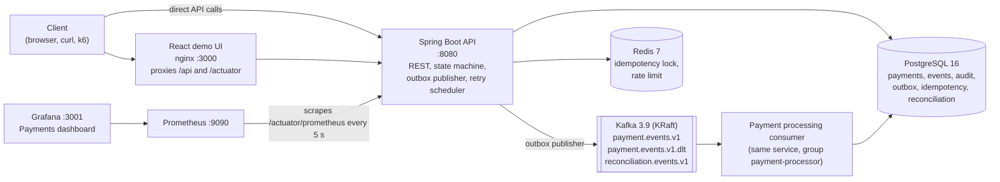
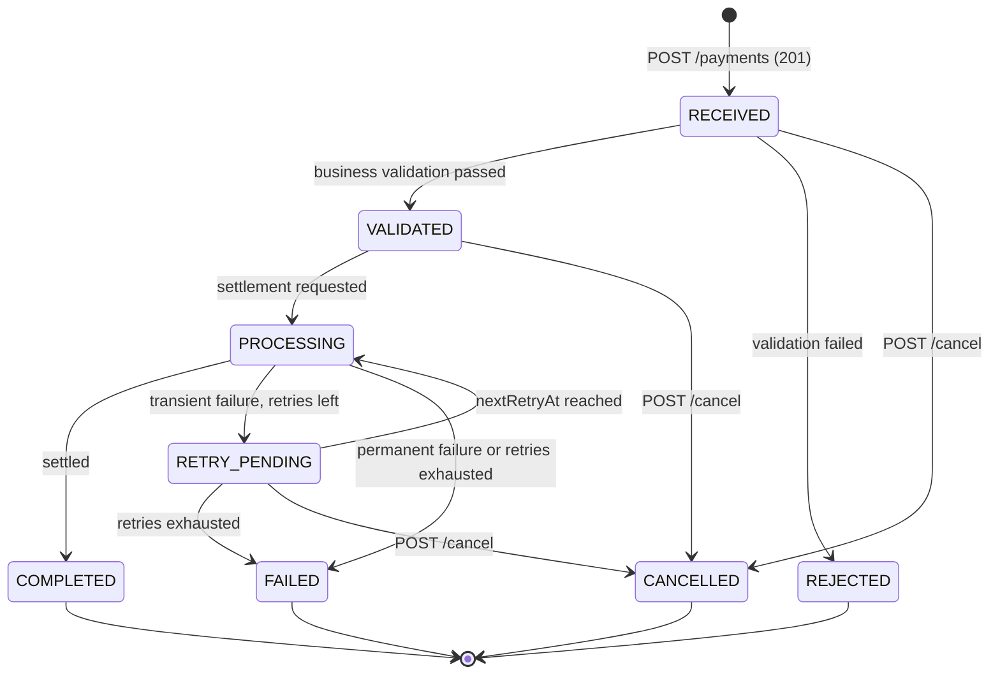
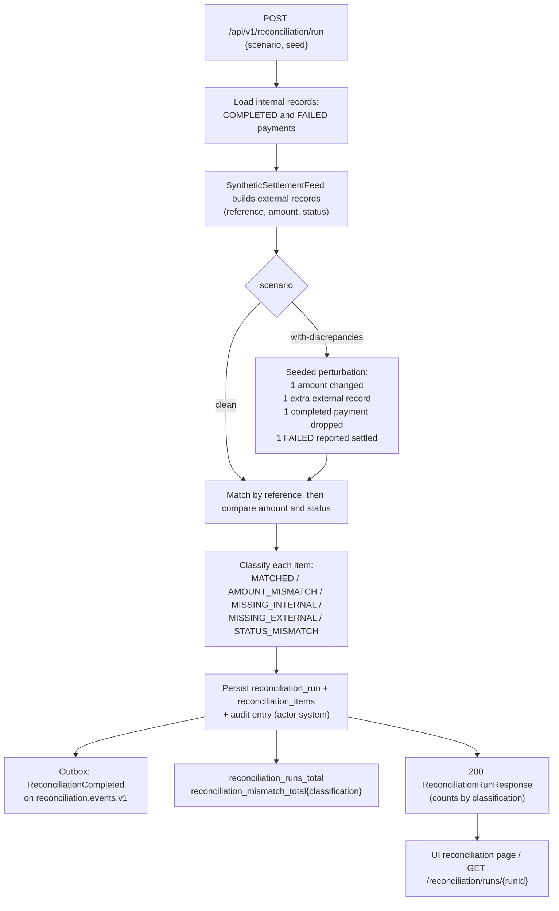

# Architecture

This document explains how the Payment Orchestration Service is put together and why. The
authoritative contract for names, ports, endpoints and fields is [`DESIGN.md`](DESIGN.md);
the reasoning behind the main choices is in the [ADRs](adr/README.md). Everything is
synthetic: no real accounts, networks or employer systems.

## 1. System architecture



### Components

| Component | Responsibility | Reference |
|-----------|----------------|-----------|
| **React demo UI** | Six pages (dashboard, create payment, list, detail, reconciliation, health) that poll the API every 3 s and make the behaviour visible. Served by nginx, which proxies `/api/` and `/actuator/` to the backend so the browser only talks to one origin. | DESIGN.md 5 |
| **Spring Boot API** | `POST/GET /api/v1/payments`, cancel, events, reconciliation, system health and stats; Bean Validation and domain rules; RFC 7807 problems; `X-Request-Id`/`X-Correlation-Id` on every response; Swagger UI; Actuator. | DESIGN.md 4.7, 4.11 |
| **Domain and state machine** | `Payment` aggregate with `Money` (BigDecimal, per-currency scale), `AccountReference`, `PaymentStatus` and an explicit transition table. Every transition writes a `PaymentEvent`, an `AuditEntry` and, when externally visible, an `OutboxEvent`, in one transaction. | DESIGN.md 4.2, 4.3 |
| **Outbox publisher** | Every 500 ms selects up to 50 `NEW` outbox rows with `FOR UPDATE SKIP LOCKED`, publishes them to Kafka keyed by `paymentId`, marks them `PUBLISHED`; exponential backoff and `FAILED` after 5 attempts. | ADR 0003 |
| **Payment processing consumer** | Consumes `payment.events.v1`; on `PaymentReceived` runs business validation, moves to `PROCESSING` and calls the `SettlementGateway`; records `COMPLETED`, `RETRY_PENDING` or `FAILED`. Idempotent: re-reads the payment and ignores stale events. `DefaultErrorHandler` with 3 attempts then dead-letter topic. | DESIGN.md 4.4, ADR 0004 |
| **Retry scheduler** | Every 1 s picks `RETRY_PENDING` payments whose `nextRetryAt` has passed (batch 20, `SKIP LOCKED`), moves them to `PROCESSING` and calls the gateway again. Backoff `2^retryCount` seconds capped at 30 s, max 3 retries. | DESIGN.md 4.4 |
| **Settlement gateway (simulated)** | Port with a simulator adapter. Settles normally; in the `demo` profile honours `X-Demo-Failure`: `settlement-timeout` (fails twice then succeeds), `settlement-rejected` (permanent), `poison-message` (consumer throws, record is dead-lettered). | DESIGN.md 4.4 |
| **Reconciliation** | Builds a synthetic settlement feed from the current COMPLETED/FAILED payments and compares; `with-discrepancies` injects one of each mismatch class deterministically. | ADR 0006 |
| **PostgreSQL** | System of record, Flyway-managed schema, unique constraints, append-only audit trigger. | ADR 0002 |
| **Kafka** | Single-node KRaft broker; versioned JSON envelope; per-payment ordering via the key; DLT. | ADR 0004 |
| **Redis** | Short idempotency lock and fixed-window rate limit; the service degrades (not fails) without it. | ADR 0007 |
| **Prometheus / Grafana** | Prometheus scrapes `/actuator/prometheus`; Grafana is provisioned with the datasource and the "Payments" dashboard (`docker/grafana/dashboards/payments.json`). | DESIGN.md 4.10 |

### Code layout (backend)

Package-by-feature under `io.github.adetlo.payments`:

* `domain`: pure Java, no Spring. Value objects, aggregate, state machine, exceptions.
* `application`: use cases and ports (`SettlementGateway`, repositories), transaction
  boundaries, the outbox and retry schedulers' logic.
* `infrastructure`: JPA entities and repositories, Kafka producer/consumer, Redis adapters,
  scheduling, the settlement simulator and the synthetic feed.
* `api`: controllers, request/response DTOs, problem-detail handling, filters (request id,
  correlation id, security headers).
* `config`, `observability`: wiring, Micrometer meters, health indicators.

## 2. Payment flow

```mermaid
sequenceDiagram
    autonumber
    participant C as Client
    participant API as Spring Boot API
    participant R as Redis
    participant DB as PostgreSQL
    participant OP as Outbox publisher<br/>(every 500 ms)
    participant K as Kafka<br/>payment.events.v1
    participant CO as Processing consumer
    participant SG as Settlement gateway<br/>(simulated)
    participant RS as Retry scheduler<br/>(every 1 s)

    C->>API: POST /api/v1/payments (Idempotency-Key)
    API->>API: Bean Validation + domain rules
    API->>R: SET idem:{key} NX PX 10000 (lock; skipped if Redis is down)
    API->>DB: read idempotency record
    alt key seen, same hash
        DB-->>API: stored 201 response
        API-->>C: 201 + Idempotent-Replayed: true
    else key seen, different hash
        API-->>C: 409 idempotency-key-reuse
    else new key
        API->>DB: BEGIN: idempotency IN_PROGRESS, payment RECEIVED,<br/>payment_event, audit_entry, outbox PaymentReceived, idempotency COMPLETED: COMMIT
        API-->>C: 201 PaymentResponse (status RECEIVED), Location header
    end

    OP->>DB: SELECT outbox NEW FOR UPDATE SKIP LOCKED (batch 50)
    OP->>K: send(key = paymentId, envelope)
    K-->>OP: ack
    OP->>DB: mark PUBLISHED (or attempts++ with backoff, FAILED after 5)

    K->>CO: PaymentReceived
    CO->>DB: re-read payment (ignore if status no longer applies)
    CO->>DB: RECEIVED -> VALIDATED (+ event, audit, outbox PaymentValidated)<br/>or -> REJECTED (+ PaymentRejected)
    CO->>DB: VALIDATED -> PROCESSING
    CO->>SG: settle(payment)
    alt settled
        CO->>DB: PROCESSING -> COMPLETED (+ PaymentCompleted)
    else transient failure
        CO->>DB: PROCESSING -> RETRY_PENDING, nextRetryAt = now + 2^retryCount s (+ PaymentRetryScheduled)
        RS->>DB: pick RETRY_PENDING due (SKIP LOCKED, batch 20) -> PROCESSING
        RS->>SG: settle(payment) again (same logic, max 3 retries)
    else permanent failure or retries exhausted
        CO->>DB: PROCESSING -> FAILED with failureReason (+ PaymentFailed)
    else consumer throws (poison message)
        K->>K: 3 attempts, 500 ms backoff, then payment.events.v1.dlt
    end
```

Key properties:

* **Atomicity**: the payment row and its side effects (event, audit, outbox, idempotency
  record) commit together; a crash anywhere leaves either everything or nothing.
* **At-least-once with idempotent consumers**: the outbox may publish twice; the consumer
  re-reads state and ignores events that no longer apply.
* **Ordering per payment**: the Kafka key is the `paymentId`, so a payment's events share a
  partition.
* **Bounded retries**: `maxRetries = 3`, exponential backoff capped at 30 s, then `FAILED`
  with a reason. Every status change is a `PaymentEvent` visible at
  `GET /api/v1/payments/{id}/events` together with the audit trail.

## 3. Payment state machine



`PaymentStateMachine.transition(payment, target)` enforces this table and throws
`InvalidStateTransitionException`, surfaced as `409 about:blank#invalid-state-transition`
(for example cancelling a payment that already completed). Terminal states are never left.

## 4. Reconciliation flow



The run is synchronous and small by design; results are append-only history, nothing is
auto-corrected. See [ADR 0006](adr/0006-reconciliation.md).

## 5. Observability

* **Logs**: JSON (logstash encoder) in the `docker` and `prod` profiles, human-readable
  locally; MDC carries `correlationId`, `requestId` and `paymentId`.
* **Metrics** (Micrometer, Prometheus registry at `/actuator/prometheus`): payment counters
  by outcome, `payment_processing_duration_seconds` timer (RECEIVED to terminal), outbox
  gauges and counter, retry and dead-letter counters, reconciliation counters, idempotency
  replay/conflict counters, plus JVM and HTTP server metrics. The Grafana dashboard groups
  them as Overview, Payment flow, Outbox and Kafka, Idempotency and reconciliation, API and JVM.
* **Health**: Actuator liveness/readiness for containers; `GET /api/v1/system/health`
  always returns 200 with per-component status (`api`, `postgresql`, `kafka`, `redis`) so the UI
  can render DEGRADED states, for example when Redis is stopped.
* **Correlation**: `X-Correlation-Id` is echoed if supplied, generated otherwise, stored on
  the payment, carried in every event envelope and in the logs.

## 6. Runtime topology (docker compose)

All seven containers share the `pos` network. Startup order is enforced with
`depends_on: condition: service_healthy`: postgres, kafka and redis first, then the backend
(its readiness healthcheck comes from the backend image), then the frontend; Grafana waits
for Prometheus. Memory limits total about 3.6 GB for a 6 GB Docker VM. Named volumes keep
PostgreSQL, Kafka and Prometheus data across restarts; `docker compose down -v` resets
everything. Ports are listed in DESIGN.md section 3 and the README.

## 7. What is deliberately simple

* One service hosts the API, the outbox publisher, the retry scheduler and the consumer;
  they are separable along the port boundaries but run together for the demo.
* No authentication: the place to add an OAuth2 resource server is the API filter chain
  (see README "Security model").
* Single broker, replication factor 1, auto-created topics, synchronous reconciliation,
  local-only benchmarks. The README's "Limitations" section lists these honestly.
